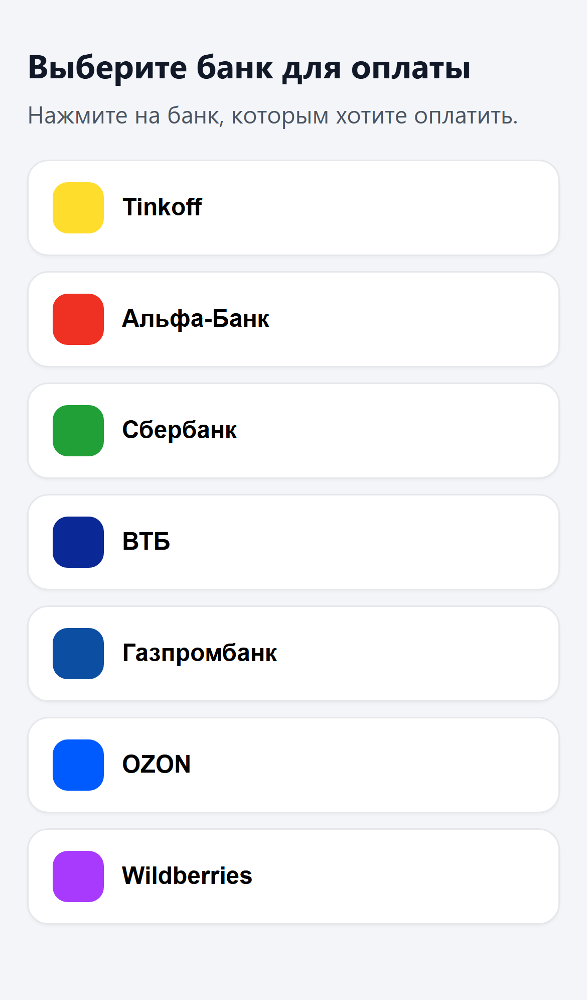
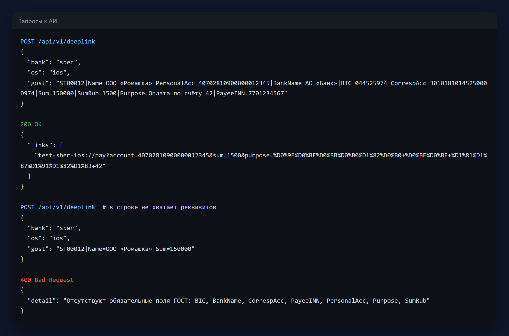
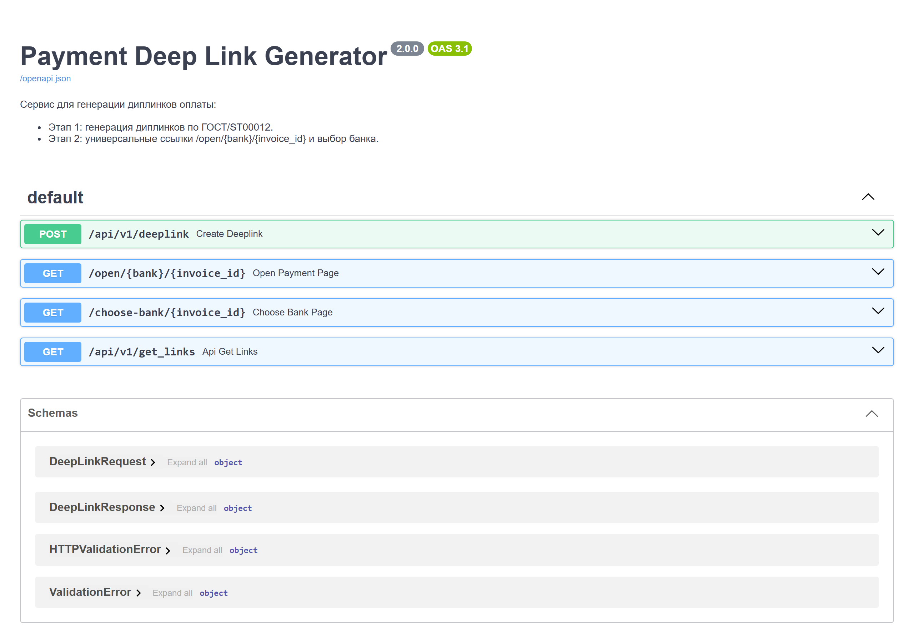
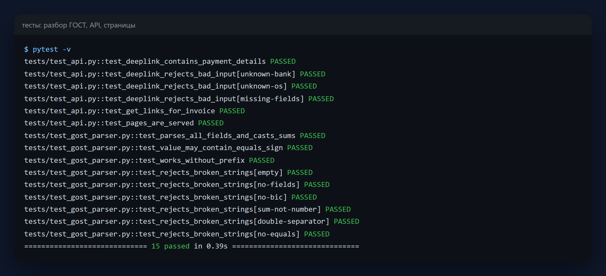

# Payment links from a payment QR code

[Русская версия](README.md)

A FastAPI service: it takes a payment QR code string in the `ST00012` format
(GOST R 56042-2014, the Russian standard for payment QR codes), validates the
payment details and returns links that open the payment in the mobile app of the
chosen bank. The service comes with two pages for the phone: bank selection and
a "smart" link that detects iOS or Android by itself.

Python 3.11+ · FastAPI · Pydantic · pytest

| Bank selection | Opening the app |
|---|---|
|  |  |

## What's inside

**Stage 1 — generating links from a GOST string.** `POST /api/v1/deeplink` takes
a bank, an OS and a string `ST00012|Name=…|PersonalAcc=…|BIC=…|…`. The string is split
into fields, amounts are converted to numbers, and the presence of the required details is checked.
A broken string, an unknown bank or OS gives a clear 400 error with the reason.



**Stage 2 — universal link.** `/open/{bank}/{invoice_id}` returns a page
that detects the phone's OS, requests the links from the server and tries to open
the bank's app with each of them in turn. If the app has not opened within a second,
it moves on to the next option, and at the end suggests installing the app.
`/choose-bank/{invoice_id}` is the bank selection page shown before payment.

Supported: T-Bank, Alfa-Bank, Sberbank, VTB, Gazprombank, Ozon, Wildberries (a large Russian marketplace).

> The links currently have a test form `test-{bank}-{os}://pay?...` — this is what
> the technical specification asked for. The real bank schemes are plugged in at one place:
> the `_build_test_link` function in `deep_links.py`; the rest of the code does not need to change.

## Running

```bash
pip install -r requirements.txt
uvicorn main:app --reload
```

- API documentation: http://127.0.0.1:8000/docs
- bank selection: http://127.0.0.1:8000/choose-bank/INV-123
- opening the payment: http://127.0.0.1:8000/open/sber/INV-123



## Tests

```bash
pytest -v
```

They check parsing of the GOST string (including broken strings: empty, without payment details,
with a non-numeric amount, with a double separator), API responses and page serving.



## Structure

```
main.py          FastAPI endpoints
gost_parser.py   parsing and validation of the ST00012 string
deep_links.py    link generation by bank and OS
link_service.py  links for the universal page
models.py        request and response models
choose_bank.html bank selection page
open_page.html   app opening page + static/open.js
tests/           pytest tests
```

## License

MIT — see [LICENSE](LICENSE).
