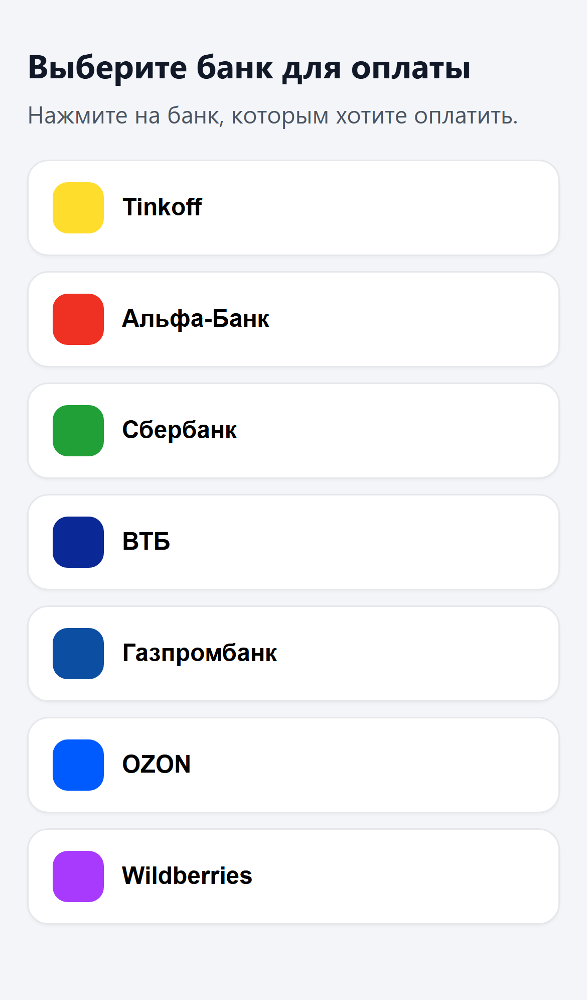
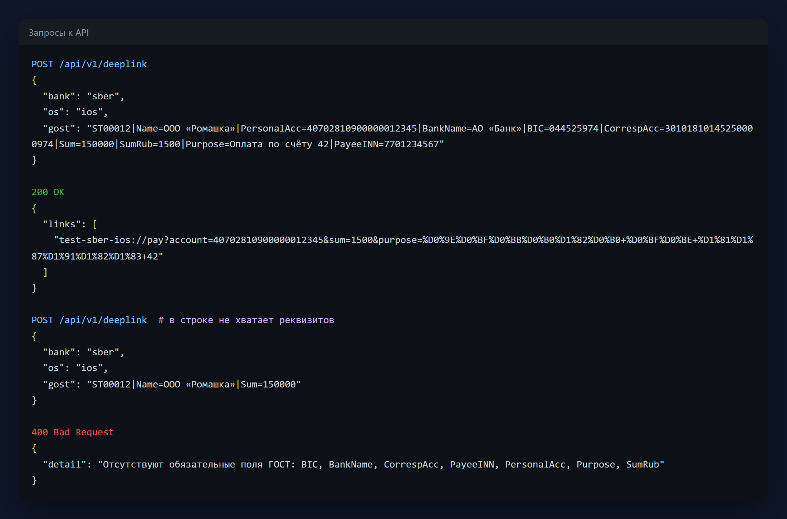
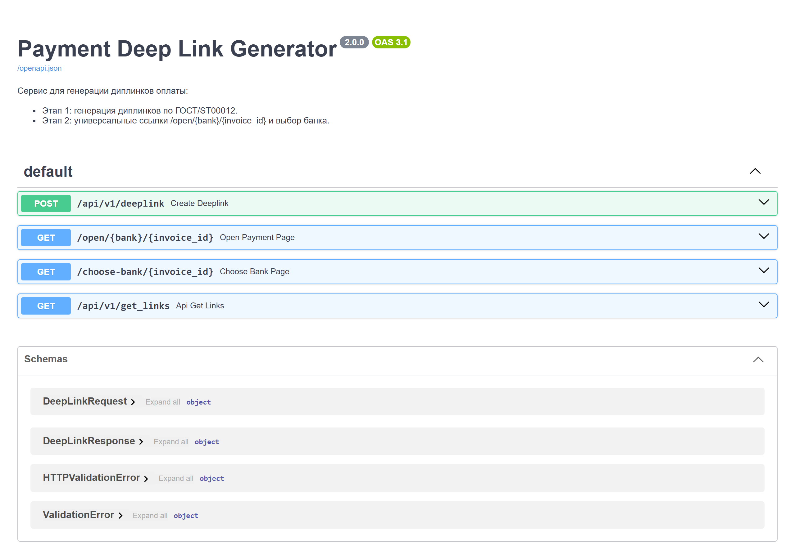
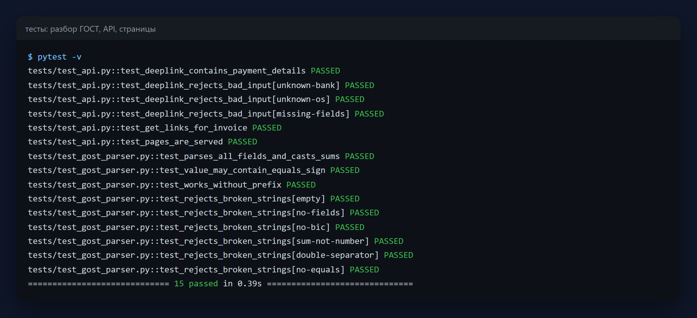

# Ссылки на оплату из платёжного QR

Сервис на FastAPI: принимает строку платёжного QR-кода в формате `ST00012`
(ГОСТ Р 56042-2014), проверяет реквизиты и выдаёт ссылки, которые открывают
оплату в мобильном приложении выбранного банка. К сервису прилагаются две
страницы для телефона: выбор банка и «умная» ссылка, которая сама определяет
iOS или Android.

Python 3.11+ · FastAPI · Pydantic · pytest

| Выбор банка | Открытие приложения |
|---|---|
|  |  |

## Что внутри

**Этап 1 — генерация ссылок по строке ГОСТ.** `POST /api/v1/deeplink` принимает
банк, ОС и строку `ST00012|Name=…|PersonalAcc=…|BIC=…|…`. Строка разбирается
на поля, суммы приводятся к числу, проверяется наличие обязательных реквизитов.
Битая строка, неизвестный банк или ОС — понятная ошибка 400 с причиной.



**Этап 2 — универсальная ссылка.** `/open/{bank}/{invoice_id}` отдаёт страницу,
которая определяет ОС телефона, запрашивает у сервера ссылки и по очереди
пробует открыть приложение банка. Если за секунду приложение не открылось —
переходит к следующему варианту, а в конце подсказывает установить приложение.
`/choose-bank/{invoice_id}` — страница выбора банка перед оплатой.

Поддерживаются: Т-Банк, Альфа-Банк, Сбербанк, ВТБ, Газпромбанк, Ozon, Wildberries.

> Ссылки сейчас тестового вида `test-{bank}-{os}://pay?...` — так было в
> техническом задании. Настоящие схемы банков подставляются в одном месте:
> функции `_build_test_link` в `deep_links.py`; остальной код менять не нужно.

## Запуск

```bash
pip install -r requirements.txt
uvicorn main:app --reload
```

- документация API: http://127.0.0.1:8000/docs
- выбор банка: http://127.0.0.1:8000/choose-bank/INV-123
- открытие оплаты: http://127.0.0.1:8000/open/sber/INV-123



## Тесты

```bash
pytest -v
```

Проверяют разбор строки ГОСТ (включая битые строки: пустую, без реквизитов,
с нечисловой суммой, с двойным разделителем), ответы API и отдачу страниц.



## Структура

```
main.py          эндпоинты FastAPI
gost_parser.py   разбор и проверка строки ST00012
deep_links.py    генерация ссылок по банку и ОС
link_service.py  ссылки для универсальной страницы
models.py        модели запроса и ответа
choose_bank.html страница выбора банка
open_page.html   страница открытия приложения + static/open.js
tests/           тесты pytest
```

## Лицензия

MIT — см. [LICENSE](LICENSE).
